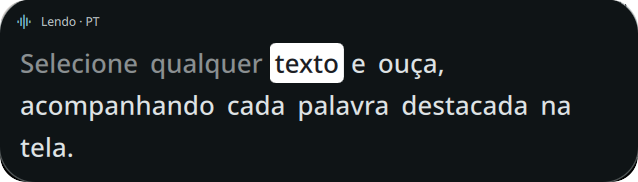
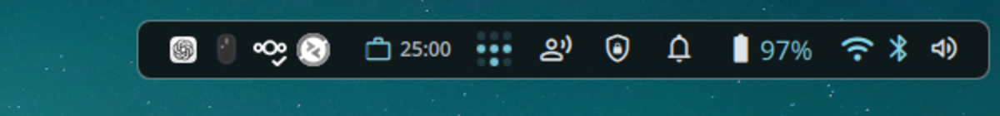
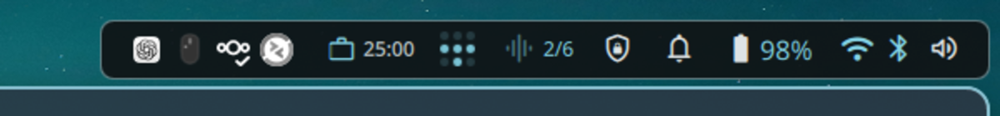
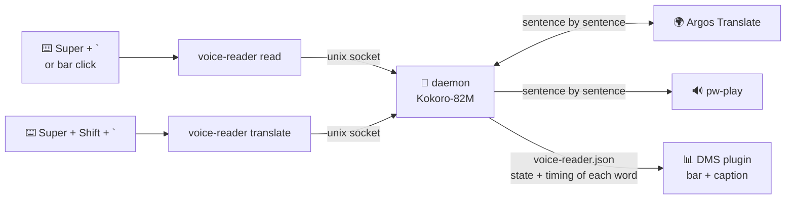

<div align="center">

# 🗣️ Voice Reader

**Select. Press <kbd>Super</kbd> + <kbd>`</kbd>. Listen.**<br>
**Add <kbd>Shift</kbd> to translate before reading.**

Text-to-speech reader for Linux, built for people with **dyslexia**:<br>
natural neural voice, **100% local**, in **Portuguese and English**, with a **caption that highlights each spoken word**,<br>
**translation from ~50 languages** and a bar plugin for **DankMaterialShell**.

[](nixos/voice-reader.nix)
[](VoiceReader/)
[](https://huggingface.co/hexgrad/Kokoro-82M)
[](https://github.com/argosopentech/argos-translate)
[](https://github.com/YaLTeR/niri)
[](LICENSE)



</div>

---

## ✨ Features

| | |
|---|---|
| 🔒 **Private** | The model runs on your machine. No text leaves your PC, no account, no API. |
| 🇧🇷 🇺🇸 **Bilingual** | Detects the language on its own: `pf_dora` for Portuguese, `af_heart` for English. |
| ⚡ **Starts fast** | Generates and plays **sentence by sentence**: a long text starts speaking in ~2 s, not ~10 s. |
| 🖱️ **Any app** | Uses the Wayland primary selection: just select, no need to copy. |
| ⏹️ **Stops instantly** | Pressed it again? Silence. |
| 📊 **In the bar** | Spinning icon while loading, waves + `sentence/total` while speaking; click reads or stops. |
| 🔦 **Caption** | A box in the top-left corner with the sentence being read; a white box follows the **spoken word**. |
| 🌍 **Translation** | <kbd>Super</kbd> + <kbd>Shift</kbd> + <kbd>`</kbd>: translates the selection from any language into Portuguese (and Portuguese into English) and reads the translation. The target language is configurable. |
| 🚀 **Always ready** | A user service starts with the session; the model stays in memory. |

## 🎛️ Bar states

| State | Icon | Look |
|---|---|---|
| Idle | `record_voice_over` |  |
| Loading | `progress_activity` spinning | colored icon rotating |
| Speaking | `graphic_eq` pulsing + `2/6` |  |

## 🔦 Word-by-word caption


When reading starts, an animated box opens in the top-left corner with the current sentence. A white box **slides to the word being spoken**; words already read are dimmed. The text under the box is drawn dark inside it, so it stays legible even mid-slide.

Each word's timing comes from Kokoro itself (English) or is estimated from word length (Portuguese), and the daemon compensates for audio latency. The box takes no clicks or focus.

In *Settings → Plugins → Voice Reader*:

| Option | Default | What |
|---|---|---|
| Show caption | on | Turns the box on/off |
| Font size | 26 px | 16–44 px |
| Box width | 640 px | 360–1100 px |

## 🌍 Translate and listen

Select text in any language and press <kbd>Super</kbd> + <kbd>Shift</kbd> + <kbd>`</kbd>:

1. The language is detected (`langdetect`).
2. [Argos Translate](https://github.com/argosopentech/argos-translate) translates **on your machine**, sentence by sentence: the first one starts playing while the rest are translated.
3. The translation is read aloud and shown in the caption as **Translation · EN → PT**, with the spoken word highlighted.

With the default target (`pt`, configurable via `VOICE_READER_TRANSLATE_TO`):

| Selected text | Becomes |
|---|---|
| Any language (English, Spanish, French, German, Japanese…) | 🇧🇷 Brazilian Portuguese |
| Portuguese | 🇺🇸 English |

The first time a new language shows up, its model (~100 MB) is downloaded and a notification tells you. Languages without a direct pair with Portuguese pivot through English. If a language has no model, a notification appears.

## 🧩 How it works



The daemon listens on `$XDG_RUNTIME_DIR/voice-reader.sock` and publishes to `$XDG_RUNTIME_DIR/voice-reader.json` the state and the sentence timeline (start in epoch ms and `[word, start, end]`); the plugin watches the file and finds the current word by the clock.

## 📦 Installation (NixOS)

**1. Module** — copy `nixos/*` to `/etc/nixos` and import it:

```nix
imports = [ ./voice-reader.nix ];
```

**2. Plugin** — copy `VoiceReader/` to `~/.config/DankMaterialShell/plugins/` (or use `programs.dms-shell.plugins`), enable it in *Settings → Plugins* and add the **Voice Reader** widget to the bar.

**3. niri keybind** (`config.kdl`):

```kdl
binds {
    Mod+grave hotkey-overlay-title="Read selected text" { spawn "voice-reader" "read"; }
    Mod+Shift+grave hotkey-overlay-title="Translate and read selection" { spawn "voice-reader" "translate"; }
}
```

**4.** `sudo nixos-rebuild switch` and you're done.

> [!NOTE]
> On first run the voice model (~330 MB) is downloaded from Hugging Face, and each translation language (~100 MB) on first use. After that it works **offline**.

## ⚙️ Settings

| Variable | Default | What |
|---|---|---|
| `VOICE_READER_SPEED` | `1.0` | Speech speed (e.g. `0.9` slower) |
| `VOICE_READER_LATENCY` | `0.1` | Delay (s) between generating audio and the sound coming out; tunes caption sync |
| `VOICE_READER_TRANSLATE_TO` | `pt` | Translation target language (`pt` or `en`); text already in it goes to the other one |

Voices live in `VOICES` in `voice-reader.py` — the [full Kokoro list](https://huggingface.co/hexgrad/Kokoro-82M/tree/main/voices) has other options.

## 📋 Requirements

- Wayland + `wl-clipboard` · PipeWire (`pw-play`)
- Runs on **CPU**; no GPU needed
- DankMaterialShell ≥ 1.4.6 (plugin only)

## ⚠️ Limitations

- Mixed-language text is read with the voice of the predominant language.
- A very long sentence without punctuation is still generated in full before playing.
- Translation is automatic and local: good for getting the gist, but it may err on technical text or slang.
- Very short texts (2–3 words) may get the wrong language detected.

---

<div align="center">

Made with ❤️ for effortless reading · [MIT](LICENSE) License · [github.com/Matheuscara/dms-voice-reader](https://github.com/Matheuscara/dms-voice-reader)

</div>
